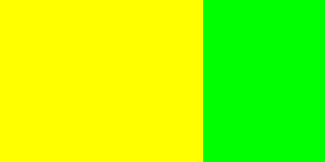

# OpenGL + SPIR-V: `sampler2DArray` samples the unit's `GL_TEXTURE_2D` binding

A SPIR-V fragment shader that declares a `sampler2DArray` reads the texture bound to the `GL_TEXTURE_2D` target of its
texture unit, not the one bound to `GL_TEXTURE_2D_ARRAY`. The same shader compiled from GLSL source samples the array
texture as expected.

Seen on an AMD Radeon RX 9070 with Adrenalin 26.11.1 (driver 32.0.32015.16001) on Windows 11.

## What the program does

It draws one full-screen triangle into each half of the window with the same shaders:

- left half: loaded as SPIR-V with `glShaderBinary` and `glSpecializeShader`
- right half: compiled from the GLSL source with `glShaderSource`

Two textures are bound to every texture unit, each on its own target:

- a two-layer `GL_TEXTURE_2D_ARRAY`: layer 0 is red, layer 1 is green
- a `GL_TEXTURE_2D` that is solid yellow

`shaders/array.frag` samples layer 1 of the array, so both halves should be green. The program reads one pixel back
from each half, prints both, and exits with 1 when they differ.

## Build

```
cmake -S . -B build
cmake --build build --config Release
```

CMake downloads GLFW 3.4. Pass `-DGLFW_LOCAL_DIR=<path>` to use an existing GLFW checkout instead.

## Run

```
build\Release\repro.exe array
build\Release\repro.exe array --no-2d
build\Release\repro.exe control2d
```

Add `--no-wait` to exit after printing instead of keeping the window open.

## Results on the RX 9070

| Command | SPIR-V program | GLSL program | Expected |
|---|---|---|---|
| `repro array` | 255 255 0 (yellow, the 2D texture) | 0 255 0 (green) | green in both |
| `repro array --no-2d` | 0 0 0 (black) | 0 255 0 (green) | green in both |
| `repro control2d` | 255 255 0 (yellow) | 255 255 0 (yellow) | yellow in both |



`repro array`: the left half (SPIR-V) shows the yellow 2D texture, the right half (GLSL) shows the green array layer.

## Shaders

The `.spv` files are checked in. They were built from the GLSL files next to them with shaderc v2022.3:

```
glslc --target-env=opengl -fshader-stage=vert shaders/fullscreen.vert -o shaders/fullscreen.vert.spv
glslc --target-env=opengl -fshader-stage=frag shaders/array.frag -o shaders/array.frag.spv
glslc --target-env=opengl -fshader-stage=frag shaders/control2d.frag -o shaders/control2d.frag.spv
```

`spirv-val --target-env opengl4.5` accepts all three.

`glad/` holds an OpenGL 4.6 loader generated by glad 0.1.36.
